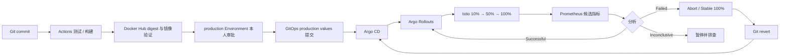

# Argo Canary

Windows + Docker Desktop + kind 上可复现的 GitOps 渐进式交付实验。应用清单只有一套 Helm chart，应用本身不依赖 kind 或云厂商。



Flask + Gunicorn 提供确定性响应。HTTP 500 / 约 800 ms 延迟由每个 Pod 模板的环境变量控制，业务故障不影响健康探针。Stable 和 Canary 不共享可变 ConfigMap。

## 快速开始

前提：Docker Desktop Linux 后端运行；安装 Git、Python 3.11+、kind、kubectl、Helm。在仓库根目录 PowerShell 中：

```powershell
python -m venv .venv
.\.venv\Scripts\Activate.ps1
python -m pip install -r requirements-lock.txt PyYAML==6.0.3

# 合并前可把 main 换成已推送的实验分支
.\scripts\bootstrap.ps1 -DeployApplication -GitOpsRef main
kubectl --context kind-argo-canary-local get nodes
kubectl --context kind-argo-canary-local -n argocd get application demo-app
curl.exe -H "Host: demo-app.local" http://127.0.0.1:18080/
```

脚本复用同名集群，不自动重建，不清理其他集群或 Docker 资源。默认单节点适合本机剩余资源；Kubernetes 节点镜像固定为 1.36.4，入口仅绑定本机 18080。原默认 kubectl context 保留，实验命令显式指定 kind-argo-canary-local。

| 平台组件 | 固定版本 |
| --- | --- |
| Istio | 1.30.8 |
| Argo CD / chart | 3.6.1 / 10.18.0 |
| Argo Rollouts / chart | 1.10.2 / 2.43.12 |
| kube-prometheus-stack / Prometheus | 93.2.2 / 3.16.0 |
| Metrics Server / chart | 0.8.0 / 3.13.0 |

按需在其他终端访问 UI：

```powershell
kubectl --context kind-argo-canary-local -n argocd port-forward svc/argocd-server 18081:80
kubectl --context kind-argo-canary-local -n monitoring port-forward svc/prometheus-kube-prometheus-prometheus 19090:9090
```

Argo CD：http://127.0.0.1:18081；Prometheus：http://127.0.0.1:19090。管理员初始密码留在集群 Secret，不进入 Git。

## 发布与恢复

CI 自动测试、构建、推送及验证候选镜像；普通推送不修改 production 期望状态。正式发布在 Actions 的 **Build, Verify and Promote → Run workflow → promote=true** 发起。production Job 必须先得到 Required reviewer 本人审批，之后才使用原生 GitHub token 提交 values-production.yaml。

候选 commit、run URL、digest 保存在运行的 verified-candidate artifact 中。部署使用 digest，不使用 latest。发布串行更新 Git，拒绝源代码已经变化的过期候选，GitOps 提交不会循环触发构建。

infra/argocd/application.yaml 跟踪 main 与 production values；bootstrap 实验入口使用同一 chart 的 lab values。切回 production：

```powershell
kubectl --context kind-argo-canary-local apply -f infra/argocd/application.yaml
```

运行时 Abort 恢复 Stable 流量，不修改 Git。必须 Git revert 修复期望状态，再等待 Argo CD 同步。

```powershell
$env:PATH = "$PWD\.local\bin;$env:PATH"
kubectl argo rollouts get rollout demo-app --context kind-argo-canary-local -n demo
kubectl argo rollouts promote demo-app --context kind-argo-canary-local -n demo
kubectl argo rollouts abort demo-app --context kind-argo-canary-local -n demo
kubectl argo rollouts retry rollout demo-app --context kind-argo-canary-local -n demo
```

Rollouts 手工 Pause/Promote 与 GitHub Environment 审批是两个独立控制点。见[实验与运维指南](docs/e2e-validation.md)。

## 验证和目录

```powershell
python -m pytest -q
helm lint infra/helm/demo-app --strict
helm template demo-app infra/helm/demo-app -n demo > .local/rendered.yaml
kubectl --context kind-argo-canary-local apply --dry-run=server -f .local/rendered.yaml
```

CI 还运行 actionlint、Blue/Green 渲染、digest / OCI revision 校验和真实容器 HTTP 检查。静态检查不能代替集群实验。

- src/、tests/：应用及回归测试。
- infra/helm/demo-app/：唯一应用清单、环境 values、schema。
- infra/argocd/：production GitOps 入口。
- infra/local/、scripts/bootstrap.ps1：固定版本本地平台。
- scripts/lab.py：真实集群实验和 HTTP 负载。
- docs/e2e-validation.md：机制、实验和恢复操作。

临时清单、工具及平台文件留在忽略的 .local/ 中，不提交指标转储或执行日志。
